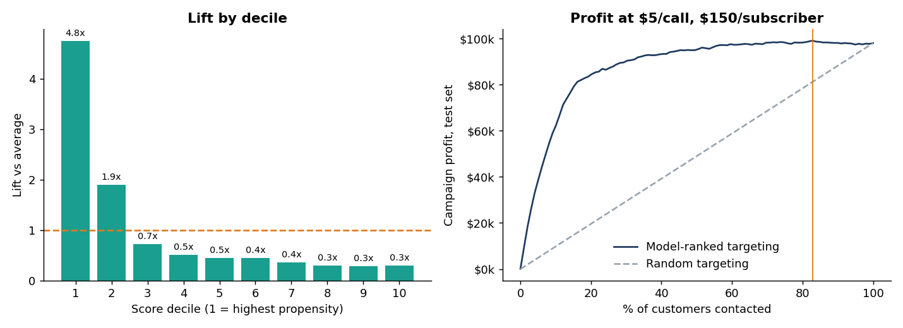
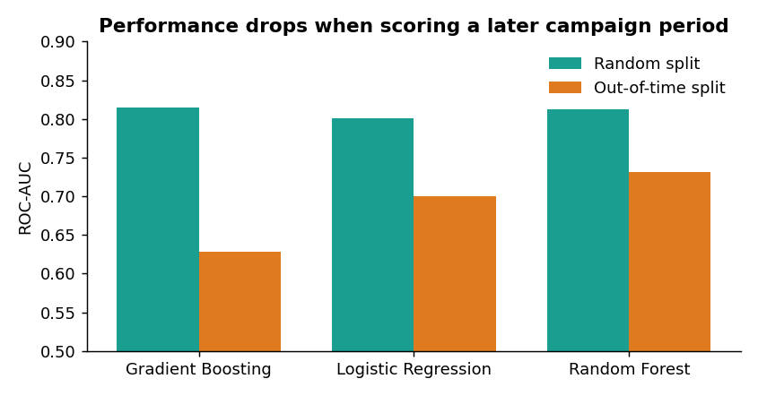

# Bank Marketing: Who to Call, How Often, and What It's Worth

*Customer segmentation, pre-call propensity modelling and campaign-targeting economics on 41,188 bank telemarketing contacts (Python · SQL · Power BI)*



## The business problem
A bank's telemarketing team promotes term deposits. Only **11.3%** of contacts subscribe, and customers are called up to 56 times. **Where should limited calling capacity go, and how much is smarter targeting worth?**

## Executive summary
| # | Finding | Evidence | Recommended action |
|---|---|---|---|
| 1 | **Past successes are the best prospects** | 3.7% of customers produce 21% of subscribers; 63% conversion (vs 9–10% for first-time prospects) | Prioritise a relationship-led re-engagement programme |
| 2 | **Long call sequences rarely end in a sale** | Customers whose campaign stopped after 1 call converted at 13.0% vs 3.6% for those who reached 10+; the "over-contacted" segment averages 12.6 calls for 3.9% conversion. These are *final* call counts and customers who subscribe stop being called, so this is not the conversion rate of the 10th call | Pilot a cap of ~3–4 attempts and redeploy the freed capacity |
| 3 | **Cellular outperforms landline, but less than the raw gap suggests** | 14.7% vs 5.2% pooled; higher in all 6 age bands and in 6 of the 7 campaign periods where both channels ran. Holding period constant the gap is ~18.6% vs 13.2% (`contact_by_period.csv`) | Prefer cellular, and A/B test it: landline calls cluster in the earliest, lowest-converting part of the file |
| 4 | **Ranking customers pre-call concentrates effort** | Top decile converts at **4.8×** average; calling the top 30% reaches **74%** of subscribers (random: 30%) | Score and work the list top-down |
| 5 | **Targeting value depends on call cost and capacity** | At $5/call & $150/subscriber break-even conversion is 3.3%, so almost everyone is worth calling and uplift is small (+$1.1k). At $20/call the optimal contact share falls to ~16% and uplift is ~$87k on the test set | Set the cutoff from the real cost of a call, not a default 0.5 probability |
| 6 | **Models decay on later campaigns** | Out-of-time ROC-AUC 0.73 vs 0.81 random split; subscription rate rose from ~3% in the earliest decile of calls to ~46% in the latest | Monitor drift and re-train regularly |

> Cost and value inputs are **scenario assumptions** (`src/config.py`), not data. The dataset has no revenue or cost fields; the full sensitivity grid is in `data/processed/profit_sensitivity.csv`.

## Approach
1. **Data audit** – kept bank "unknown" answers as an explicit level, engineered contact-history features, flagged duplicates, preserved chronological order.
2. **Leakage control** – `duration` (call length) is only known after the call, so it is excluded from all targeting models (enforced by a unit test). `campaign` (contacts in this campaign, including the last) is also not strictly known pre-call; it is kept, and a robustness run without it changes ROC-AUC by only −0.002 (random split) and −0.014 (out-of-time), see `campaign_feature_ablation.csv`.
3. **Segmentation** – K-Means on customer and contact-history traits only. Macro-economic variables were removed because the earlier clustering separated calendar periods rather than customers. k=4 was chosen for commercial interpretability; silhouette is low (~0.16; k=2 scores higher at 0.58, so the four segments are a business choice rather than a statistical one), so segments are a practical heuristic, not natural clusters. Segment names are rule-based on prior outcome and call count, so the segments partly restate findings 1 and 2.
4. **Modelling** – Logistic Regression, Random Forest, Gradient Boosting; **two validation schemes** (stratified random split and out-of-time split on the latest 20% of calls); with and without macro features; PR-AUC alongside ROC-AUC for the imbalanced target. Random Forest chosen for stability.
5. **Business translation** – decile lift, cumulative gains, profit curves and a cost × value sensitivity grid.



| Segment | Share of customers | Subscription rate | Share of all subscribers |
|---|---|---|---|
| Re-engaged past successes | 3.7% | 63.4% | 20.9% |
| Younger first-time prospects | 57.8% | 9.6% | 49.5% |
| Established first-time prospects | 34.3% | 9.3% | 28.2% |
| Over-contacted prospects | 4.2% | 3.9% | 1.5% |

## Honest limitations
- Observational, single-bank data (Portugal, 2008–2010): patterns are associations, **not causal**. Next step: a controlled pilot of the segment playbook.
- Channel and month effects are confounded with campaign period (landline calls are the *only* channel in the first 30% of the file; high-rate months are also the lowest-volume months, which suggests selection effects). The period-adjusted comparison in finding 3 reduces but cannot remove this.
- Contact counts are outcome-driven: customers who subscribe stop being called, so call-count patterns overstate how unproductive extra calls are.
- Macro-economic features act partly as a time proxy; removing them lowers random-split AUC by ~0.03 (see notebook 04).
- Segments are descriptive and depend on selected variables.
- The `duplicates` (12 exact rows) were retained as they may be distinct clients.

## Reproduce
```bash
pip install -r requirements.txt
python -m src.run_pipeline   # regenerates data/processed/* and images/*
python sql/run_queries.py    # runs the SQL analyses (SQLite)
python -m pytest -q          # 9 tests: leakage, chronology, gains/profit/sensitivity logic, segmentation
```
Or `make all`. The pipeline takes about 2 minutes. Notebooks are committed with outputs; re-execute them with `pip install -r requirements-notebooks.txt && make notebooks`.

## Repository map
```
src/            data.py · segmentation.py · modelling.py · business.py · run_pipeline.py
notebooks/      01 audit · 02 EDA · 03 segmentation · 04 modelling · 05 business insights (executed)
sql/            window-function queries + runner (SQLite)
powerbi/        dashboard build plan (the .pbix is not included)
data/           raw/ · processed/ (tables, gains, profit, sensitivity, Power BI extract)
docs/           data dictionary
tests/          pytest suite
.github/        CI (runs the tests)
```

## Data
Moro, S., Rita, P., & Cortez, P. (2014). *Bank Marketing* [UCI Machine Learning Repository]. `bank-additional-full`, 41,188 rows, 20 inputs. The dataset is the property of its authors and is **not** covered by this repo's MIT licence; check the UCI page for its terms. The copy in `data/raw/` carries a few extra project-added columns, described in `docs/DATA_DICTIONARY.md`.
